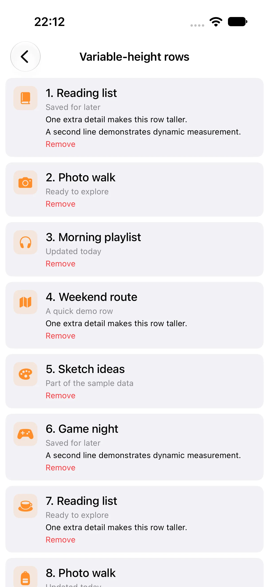
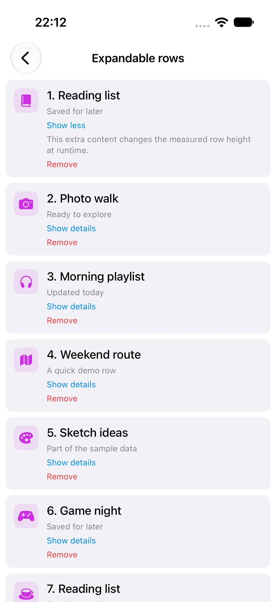
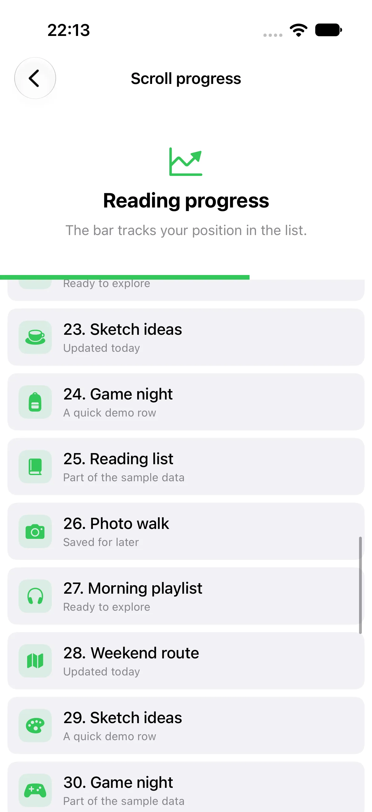

# 🧪 LazyScrollStack Demo

The demo app contains focused examples for exploring `LazyScrollStack` behavior and comparing it with standard SwiftUI containers.

## 📱 Demo

  
  
  

Variable-height rows · Expandable rows · Scroll progress

## ▶️ Run the demo

Open `LazyScrollStackDemo.xcodeproj`, select the `LazyScrollStackDemo` scheme and an iOS Simulator, then run the app.

## 🧩 Scenarios

- Fixed-height lists with 5, 100, or 1,000 rows
- Variable-height lists with 5, 100, or 1,000 rows
- Horizontal scrolling
- Expandable rows with live height changes
- Pagination with a custom footer
- Pagination with scroll progress
- A 1,000-row comparison of `List`, `LazyVStack`, and `LazyScrollStack`

See the [main README](../../README.md) for API examples, configuration, and benchmark results.
